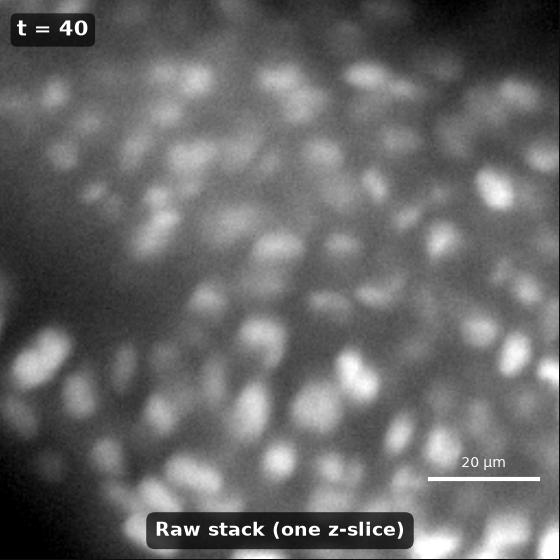
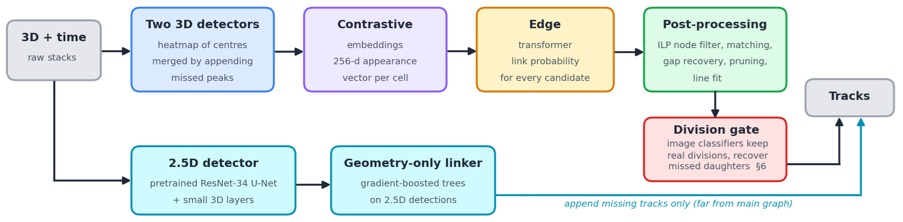

# Biohub – Cell Tracking During Development

10th place solution to the
[Biohub – Cell Tracking During Development](https://kaggle.com/competitions/biohub-cell-tracking-during-development)
Kaggle competition. The approach is described in the
[write-up](https://www.kaggle.com/competitions/biohub-cell-tracking-during-development/writeups/10th-place-solution-grandmaster-powered-agentic-a).

## The competition



The task is to track cells through 3D+time microscopy videos of developing
embryos: detect every cell in every frame, and link each cell to itself in the
next frame, or to its two daughters when it divides. Each video is an OME-Zarr
volume `(T, Z, Y, X)` with voxels of 1.625 × 0.406 × 0.406 µm. The
training set covers two embryos, `44b6` and `6bba`, and the public and private
test sets are two further embryos.

The ground truth is sparse. Only a few percent of the cells are annotated, as
[tracksdata](https://github.com/royerlab/tracksdata) `.geff` graphs whose nodes
are cell centres `(t, z, y, x)` and whose edges link a cell to the next frame.
A division is a node with two children. Predictions are scored only where the
annotation can judge them, by edge Jaccard (adjusted for the number of
predicted nodes) plus 0.1 × division Jaccard. See [`metrics.md`](metrics.md).

## This repository



It contains the training code for the models used by Theo's part of the pipeline. 
- 3D detector cell detectors
- A Contrastive model that gives each cell an appearance embedding
- A Transformer that scores candidate links,
- The post-processing that builds the tracks
- An ensemble of image classifiers that cleans up the divisions.

`train.sh` runs every step below, from raw data to the folders the kernel
loads:

```bash
uv sync                  # 1. environment
# 2. data: see "Data" below
./train.sh               # 3. every training step, in order
```

We share trained weights for the final models [on Kaggle](https://www.kaggle.com/datasets/theoviel/biohub-weights-2).


## Pipeline

| Step (`train.sh`) | Trains / produces | Kernel variable | Code |
|---|---|---|---|
| `detector_r0` | bootstrap detector: synthetic-pretraining checkpoint + fold models for pseudo-labels | — | `src/main_track.py`, `src/tracking/` |
| `pseudo_labels` | pseudo-labels on the train split | — | `src/main_predict.py --pl`, `src/main_postprocess.py --pl` |
| `detector` | the detector (temporal 3D U-Net) and its out-of-fold detections | `TRACK_W_BASE` | `src/main_track.py`, `src/main_predict.py` |
| `merge` | node set: our detections + the teammate's | — | `scripts/merge_detectors.py` |
| `netr` | NETr node embeddings, written into the node set | `CONTRASTIVE_W` | `src/main_contrastive.py`, `src/inference_contrastive.py`, `src/embeddings/` |
| `edge` | edge transformer (HOCT) and its out-of-fold link candidates | `EDGE_W` | `src/main_edge.py`, `src/main_edge_predict.py`, `src/edge_transformer/` |
| `forks` | three pools of division forks, labelled against the annotation | — | `src/division_cls/gen_fork_candidates.py`, `scripts/union_pools.py` |
| `division` | one division classifier per pool | `DIVISION_W`, `DIVISION_ENS_W` | `src/main_division.py`, `src/division_cls/` |
| `package` | copies every model the kernel loads into `dataset/` | — | `scripts/copy_to_dataset.py` |

Each step trains on the previous step's output. The post-processing the kernel
applies to the edge candidates (ILP, gap recovery, fork harvest) is
`src/main_edge_postprocess.py` and `src/postprocessing/`; the `edge` step also
scores it out of fold.

## 1. Environment

Python 3.11–3.13 and [uv](https://docs.astral.sh/uv/):

```bash
uv sync      # creates .venv/ from uv.lock
```

`train.sh` uses `.venv/bin/python` (override with `PY=...`) and one process per
visible GPU (override with `N_GPUS=...`). The pipeline was last run on 8 GPUs
(the shipped models) and smoke-tested on 4×H100 80 GB.

## 2. Data

Everything goes under `input/` and `logs/`, both git-ignored.

**Competition data** (~80 GB). Needs a Kaggle API token
([docs](https://github.com/Kaggle/kaggle-api#api-credentials)) and the
competition rules accepted:

```bash
uv run kaggle competitions download -c biohub-cell-tracking-during-development -p input
unzip -q input/biohub-cell-tracking-during-development.zip -d input
rm input/biohub-cell-tracking-during-development.zip
```

This gives `input/train/{name}.zarr` + `{name}.geff` (the annotated stacks;
some stacks have no `.geff` and are not used), `input/test/`,
`input/metadata.csv` and `input/sample_submission.csv`.

**Synthetic sequences** (1000 sequences, ~48 GB), used to pretrain
the detector. The generator (`src/data_gen/`) is calibrated on the first
embryo's stacks:

```bash
uv run python scripts/make_synthetic.py --version 5
ln -s v5 input/synthetic/v4
```

The detector reads `input/synthetic/v5` (synthetic pretraining) and
`input/synthetic/v4` (pretraining, mixed with real data). The shipped models
used a `v4` generated by an earlier version of the generator, data can be shared on request.
The current one gives identical data for both versions, hence the link.
`notebooks/SyntheticData.ipynb` runs the same generation interactively, with
visual checks.

**Teammate detections.** The node set adds the detections of Eduardo's
`current_mean3` detector. Its training code is not in this repository; only
its out-of-fold predictions on the 199 annotated stacks are used. They come in
the private bundle `biohub-oof-detectors-v001.zip` (ask the teammate; a copy is
in `output/`):

```bash
mkdir -p logs/eduardo_current_mean3/preds_r6_0.05
unzip -q -j output/biohub-oof-detectors-v001.zip 'predictions/current_mean3/*' \
    -d logs/eduardo_current_mean3/preds_r6_0.05
```

## 3. Training

```bash
./train.sh                         # every step
./train.sh netr edge               # only some steps
```

Each training step creates a run folder:

- the detector runs go in `logs/<date>/<n>/`,
- NETr runs in `logs/contrastive/<date>/<n>/`,
- edge runs in `logs/edge_run/<date>/<n>/`,
- division runs in `logs/division/<date>/<n>/`.

`train.sh` records each run folder in `logs/pipeline_runs.env`, and later steps
read it from there. So a step can be rerun alone, and it picks up the latest
runs of the steps before it. Each run trains one model per held-out embryo
(`fold_0` holds out `44b6`, `fold_1` holds out `6bba`). These give the
out-of-fold numbers and predictions that the next step trains on. Each run also
trains a `fold_fullfit` model on both embryos, and that is the one the kernel
loads.

Measured on 8 GPUs for the shipped runs: detector ~3.5 h, NETr ~40 min, edge
~35 min. The bootstrap detector costs about as much as the detector.

What each step does:

1. **`detector_r0`**: a first detector. Stage 1 pretrains on synthetic
   sequences only and saves `fold_0/ckpt_synthetic.pt`. Stage 1.5 then trains
   on real stacks mixed with synthetic ones, with weak positives taken from
   image peaks. Two fold models, no fullfit.
2. **`pseudo_labels`**: each fold model predicts its own training embryo at
   thresholds 0.3–0.6. The best threshold is post-processed, without the
   node-dropping stages, into `<run>/preds_pl_pp/`.
3. **`detector`**: the shipped recipe (`main_track.py` defaults), starting
   from step 1's synthetic checkpoint and using step 2's pseudo-labels as weak
   positives. It then predicts the held-out embryos into `preds_0.30/` and
   `preds_0.60/` (NMS radius 6 µm).
4. **`merge`**: keeps our detections ≥ 0.45, and adds the teammate's
   detections ≥ 0.35 that lie more than 7 µm from all of ours, per frame. The
   output goes to `logs/ensemble/v16_retrain/`. The kernel checks that the edge
   model's node set has `v16_` in its name.
5. **`netr`**: trains NETr on the detector's `preds_0.60` crops, then writes
   one embedding per merged node, out of fold, into the same npz files under
   `embeddings_contrastive_<date>_<n>`.
6. **`edge`**: trains the edge transformer on the merged nodes and their
   embeddings. It then writes every candidate link out of fold to
   `preds_0.45/`, and scores the kernel's post-processing on them.
7. **`forks`**: harvests three pools of division forks from those candidates:
   - `ours`: the ILP's own forks;
   - `edu`: a geometric proposer with the ILP off;
   - `union`: both pools concatenated.

   Each fork is labelled positive or negative where the annotation can say,
   and unlabelled elsewhere.
8. **`division`**: trains one ConvNeXt-tiny classifier per pool (fullfit
   only). The kernel averages the three classifiers' probabilities and deletes
   the forks below 0.5.
9. **`package`**: see the next section.

**Differences from the shipped models.** The shipped runs used intermediate
runs that no longer exist, so a rerun differs in three places:

- The shipped detector's pseudo-labels came from a chain of earlier detectors
  (`2026-09-01/9`, which itself used `2026-08-31/33`). Steps 1–2 replace that
  chain with one bootstrap round.
- The shipped NETr was trained on the detections of a sibling detector
  (`logs/2026-09-25/4`, trained with extra data that is not in this
  repository). Step 5 uses the detector from step 3 instead.
- The synthetic `v4` (see "Data").

Everything else (configurations, thresholds, the merge, the post-processing,
the fork pools) is the shipped recipe. The run folders the shipped models came
from are the `main_*.py` defaults.

**Smoke test.** `SMOKE=1 ./train.sh` runs every step on 3 stacks per embryo
and 8 synthetic sequences, with 4 iterations per training stage. It writes to
`input_smoke/` and `logs_smoke/` and takes about 45 minutes on 4 GPUs. It only
checks that the chain runs: the models it trains detect nothing. So in smoke
mode, NETr crops around the merged nodes, and the fork pools are harvested
from the shipped edge run's candidates (`logs/edge_run/2026-09-28/0`).

## 4. Updating the kernel

`./train.sh package` (included in a full run) copies the following into
`dataset/`:

```
tracking_<date>_<n>/        -> TRACK_W_BASE
contrastive_<date>_<n>/     -> CONTRASTIVE_W
edge_<date>_<n>/            -> EDGE_W
division_pool28_ours/       -> DIVISION_W
division_pool28_edu/        \
division_pool28_union/      -> DIVISION_ENS_W
```

Upload it as a new version of the weights dataset (`dataset/dataset-metadata.json`
holds its id):

```bash
uv run kaggle datasets version -p dataset -m "retrain" --dir-mode zip
```

Then, in the kernel's configuration cell, point the variables in the table above
at the new folder names. Do the same for the code: pushing to `master` uploads
`src/` as the `biohub-cell-tracking-code` dataset
(`.github/workflows/main.yaml`), which the kernel copies in its first cell.
